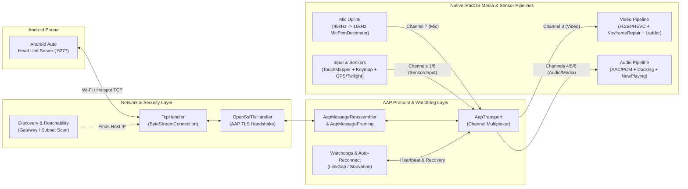

# CarAutoPad

[](https://github.com/Bryan-Maki/CarAutoPad/releases)
[](.github/workflows/build-ipa.yml)
[](https://developer.apple.com/ipados/)
[](https://swift.org)
[](LICENSE.txt)


**A native, pure-wireless Android Auto head unit receiver for iPadOS with edge-to-edge full-screen adaptation.**

**CarAutoPad** transforms any modern iPad into a high-performance, wireless Android Auto head unit—without requiring a jailbreak, TrollStore, or wired USB host privileges. Built natively in Swift, it implements a complete Android Auto Protocol (AAP) stack over Wi-Fi (`Port 5277`), hardware-accelerated H.264/HEVC video decoding, multi-channel audio ducking, iOS Lock Screen **Now Playing** integration, and self-healing link recovery.

## Table of Contents

- [About](#about)
- [Features](#features)
- [Tech Stack](#tech-stack)
- [Architecture](#architecture)
- [Project Structure](#project-structure)
- [Getting Started](#getting-started)
  - [Option 1: Sideload Prebuilt IPA (Recommended)](#option-1-sideload-prebuilt-ipa-recommended)
  - [Option 2: Build from Source](#option-2-build-from-source)
  - [Connecting Your Android Phone](#connecting-your-android-phone)
- [Configuration](#configuration)
- [Security](#security)
- [How to Contribute?](#how-to-contribute)
- [What's Next?](#whats-next)
- [License](#license)
- [Acknowledgements](#acknowledgements)
- [Author](#author)

## About

Running Android Auto on an iPad has traditionally suffered from major compromises: wired USB-C accessory restrictions, thick 16:9 letterboxed black bars on 4:3 or 3:2 iPad screens, audio routing conflicts, and video freezes over unstable mobile hotspots.

**CarAutoPad** solves these issues from the ground up:

- **100% Pure-Wireless & Sandbox-Compliant**: Operates strictly over standard iPadOS networking APIs (`Wi-Fi Hotspot` or `Local LAN` on TCP port `5277`). All private USB/IOKit entitlements are stripped so anyone can sideload the standard `.ipa` using a free Apple ID via [SideStore](https://sidestore.io/), [AltStore](https://altstore.io/), or [Sideloadly](https://sideloadly.io/).
- **Native iPad Aspect Ratio Adaptation**: Negotiates protocol-level `width_margin` and `height_margin` cropping with the Android phone so Coolwalk split-screen cards fill your iPad's 4:3 or 3:2 display edge-to-edge without geometric distortion.
- **In-Vehicle Resilience**: Engineered with a modular `*Policy` architecture ported and adapted from [open-headunit](https://github.com/andreknieriem/open-headunit), featuring automatic packet-loss keyframe repair, runtime video decoder fallback ladders, and seamless link-drop reconnection with playback state restoration.

## Features

| Category | Feature | Description |
| :--- | :--- | :--- |
| **Connectivity** | **Active Port 5277 Discovery & Auto-Reconnect** | Automatically detects your phone's hotspot gateway or scans the local subnet (`DiscoverySubnetPolicy`), with exponential-backoff auto-reconnect (`AutomaticReconnect`) and automatic music resume (`AutoResumePlaybackPolicy`). |
| **Display & UI** | **Full-Screen Margin Cropping & Live DPI Preview** | Eliminates 16:9 black bars via `MarginStrategyPolicy` and `VideoFitPolicy` (`Fill Margin`, `Fit`, `Stretch`). Includes an interactive **Live DPI Preview (`DpiPreviewView`)** (`100–320 DPI`) and Left/Right-Hand Drive (`LHD`/`RHD`) switching. |
| **Dashboard** | **Automotive Dual-Column Home & Settings Center** | Card-based dashboard (`MainViewController`) with a live status pill, direct IP connection hub, step-by-step setup guide, 6 interactive quick-spec tiles, and a native `.insetGrouped` settings modal (`SettingsViewController`). |
| **Video Pipeline** | **Hardware H.264 / HEVC Decoding & Self-Healing** | Low-latency `VideoToolbox` rendering (`H264VideoRendererView`) up to `4K 60FPS`, backed by one-time codec locking, packet-loss keyframe recovery (`KeyframeRepairTracker`), and an automatic resolution fallback ladder (`DecoderConfigLadder`). |
| **Audio & Media** | **Hardware AAC/PCM, Ducking & Lock Screen Sync** | Decodes compressed `AAC-LC` and uncompressed `PCM` audio (`AacAudioDecoder`, `PCMAudioPlayer`), smoothly ducks music during navigation prompts (`MixerDuckingEnvelope`), and syncs track metadata & album art to the iPadOS Lock Screen (`NowPlayingCoordinator`). |
| **Voice & Identity** | **On-Demand Mic Routing & Single Vehicle Identity** | Supports `Follow Audio Output`, `iPad Microphone` (48kHz-to-16kHz anti-aliased decimation via `MicPcmDecimator`), and `Phone / Car BT Mic` under a unified vehicle profile (`iPad-CarAutoPad-moto`) that prevents duplicate car entries on your phone. |
| **Sensors & Input** | **Astronomical Twilight, Signed GPS & Keymaps** | Computes local sunrise/sunset times offline via NOAA solar algorithms (`TwilightCalculator`), forwards full signed GPS coordinates (`LocationCapture`), and maps hardware keyboards & Bluetooth steering wheel buttons (`KeymapManager`). |
| **Diagnostics** | **Real-Time Performance HUD & Profile Backup** | Monitors live FPS, decode latency, and bitrate (`PerformanceOverlayView`), tests audio output (`AudioStreamTester`), surfaces network alerts (`ConnectionIssueBannerPolicy`), exports logs (`LogExporter`), and backs up settings to JSON (`SettingsBackupManager`). |

## Tech Stack

| Layer | Technology / Framework | Purpose |
| :--- | :--- | :--- |
| **Language & UI** | `Swift 5.0`, `UIKit` | Native iPadOS interface, Auto Layout, and first-responder hardware key handling |
| **Networking** | `Network.framework`, POSIX Sockets | Asynchronous TCP transport (`TcpHandler`), subnet scanning, and `NWPathMonitor` reachability |
| **Cryptography** | `OpenSSL-Universal (~> 3.6)` | In-memory BIO TLS handshake (`OpenSslTlsHandler`) required by the Android Auto protocol |
| **Protocol Serialization** | Custom Swift Protobuf Wire Codec | Zero-overhead binary encoding/decoding (`ProtoWire`, `*Proto.swift`) and fragmented frame reassembly |
| **Video Decoding** | `VideoToolbox`, `AVFoundation` | Hardware-accelerated `H.264` and `HEVC (H.265)` decompression via `AVSampleBufferDisplayLayer` |
| **Audio & Media** | `AudioToolbox`, `AVFAudio`, `MediaPlayer` | Hardware `AAC-LC` decoding, multi-stream PCM playback, audio ducking, and `MPNowPlayingInfoCenter` |
| **Location & Sensors** | `CoreLocation` | GPS coordinate streaming and offline astronomical twilight solar calculations |
| **CI/CD & Testing** | `XCTest`, `GitHub Actions` | Automated simulator unit test suites and unsigned `.ipa` release packaging (`build-ipa.yml`) |

## Architecture

**CarAutoPad** decouples network transport, protocol framing, media pipelines, and decision policies into strictly isolated layers. All socket reads, OpenSSL TLS encryption/decryption, NAL unit parsing, hardware video decoding, and audio decimation execute on dedicated background queues so the main UI thread remains responsive.



## Project Structure

```text
HeadunitPad-Auto/
├── .github/workflows/
│   └── build-ipa.yml               # CI workflow: runs XCTest suite & packages unsigned IPA
├── CarAutoPad/
│   ├── Core/
│   │   ├── AAP/                    # Android Auto Protocol core
│   │   │   ├── Framing/            # Fragmented frame reassembly & audit policies
│   │   │   ├── Messages/           # ServiceDiscovery, TouchEvent, VideoFocus & UI config messages
│   │   │   ├── Proto/              # Strongly-typed Protobuf wire codecs (Control, Media, Sensors, Input)
│   │   │   ├── Protocol/           # AAP channel definitions (Control, Sensor, Video, Audio, Mic, Input)
│   │   │   ├── Watchdog/           # LinkGapMonitor, VideoStarvationPolicy & AutomaticReconnect
│   │   │   ├── AapMessage.swift
│   │   │   ├── AapTransport.swift
│   │   │   └── AapVersionNegotiation.swift
│   │   ├── Audio/                  # Audio decoding, mixing & microphone capture
│   │   │   ├── Codec/              # Hardware AAC-LC decoder, recovery & sink announcement policies
│   │   │   ├── Mic/                # 48kHz->16kHz PCM decimator & chunk accumulator
│   │   │   ├── Mixer/              # Smooth navigation audio ducking envelope
│   │   │   ├── MicrophoneCapture.swift
│   │   │   ├── NowPlayingCoordinator.swift
│   │   │   └── PCMAudioPlayer.swift
│   │   ├── Diagnostics/            # Runtime logging, AudioStreamTester, issue banners & LogExporter
│   │   ├── Location/               # CoreLocation GPS capture & NOAA TwilightCalculator
│   │   ├── Network/                # TCP socket transport, OpenSSL TLS, Arbiter & port 5277 discovery
│   │   ├── Settings/               # Resolution, DPI, margin policies, ProjectionSettings & JSON backup
│   │   ├── UI/                     # SettingsViewController, DpiPreviewView, TouchInputView & KeymapManager
│   │   └── Video/                  # H.264/HEVC NAL parser, H264VideoRendererView, Ladder & KeyframeRepair
│   ├── Resources/Raw/              # Embedded TLS client certificate and private key for AAP handshakes
│   ├── AppDelegate.swift
│   ├── MainViewController.swift    # Automotive dual-column dashboard & projection host controller
│   ├── SceneDelegate.swift
│   ├── CarAutoPad.entitlements     # Clean sandbox entitlements (zero private USB/IOKit keys)
│   └── Info.plist
├── CarAutoPadTests/                # Comprehensive unit & smoke tests across Phases 1–9
├── scripts/
│   └── build_unsigned_ipa.sh       # Automated CLI script to build & verify unsigned CarAutoPad.ipa
├── Podfile                         # CocoaPods manifest (OpenSSL-Universal ~> 3.6, iOS 17.0+)
├── PRD.md                          # Product Requirements Document & engineering phase history
├── LICENSE.txt                     # GNU Affero General Public License v3.0
└── README.md
```

## Getting Started

### Option 1: Sideload Prebuilt IPA (Recommended)

Because **CarAutoPad** uses zero private Apple entitlements, you can install it on any non-jailbroken iPad running **iPadOS 17.0 or later** using a free Apple ID:

1. Download the latest `CarAutoPad.ipa` from the [Releases](https://github.com/Bryan-Maki/HeadunitPad-Auto/releases) page (latest release: `v0.5.0-beta`).
2. Sign and sideload `CarAutoPad.ipa` onto your iPad using [SideStore](https://sidestore.io/), [AltStore](https://altstore.io/), [Sideloadly](https://sideloadly.io/), or an Apple Developer certificate.
3. Launch **CarAutoPad** on your iPad and grant **Local Network**, **Microphone**, and **Location** permissions when prompted.

> **Note:** Thanks to its independent bundle identifier (`com.bryanmaki.CarAutoPad`), **CarAutoPad** can be installed side-by-side with the original `HeadunitPad` app without overwriting your existing installation.

### Option 2: Build from Source

#### Prerequisites

- **macOS** with **Xcode 15.0+** (iOS/iPadOS 17.0+ SDK)
- **CocoaPods** (`brew install cocoapods`)

#### Step-by-Step Build Instructions

```bash
# 1. Clone the repository
git clone https://github.com/Bryan-Maki/HeadunitPad-Auto.git
cd HeadunitPad-Auto

# 2. Install CocoaPods dependencies (OpenSSL-Universal)
pod install

# 3. Open the workspace in Xcode
open CarAutoPad.xcworkspace
```

In Xcode, select the **CarAutoPad** scheme, choose your physical iPad or an iPad Simulator, configure your signing team under **Signing & Capabilities**, and press `Cmd + R` to build and run.

To package a standard unsigned `.ipa` from the command line (identical to the CI release artifact):

```bash
bash scripts/build_unsigned_ipa.sh
# Output: .build/UnsignedIPA/CarAutoPad.ipa
```

### Connecting Your Android Phone

1. **Enable Android Auto Developer Mode (First-Time Setup)**:
   - On your Android phone, open **Settings → Connected devices → Connection preferences → Android Auto**.
   - Scroll to the bottom and tap **Version** 10 times until Developer Mode is unlocked.
2. **Start Head Unit Server**:
   - Tap the three-dot menu in the top-right corner of Android Auto settings and select **Start head unit server**.
3. **Connect Network**:
   - Connect your iPad to your Android phone's **Personal Wi-Fi Hotspot** (recommended for in-car use), or connect both devices to the same Wi-Fi LAN.
4. **Launch Projection**:
   - Open **CarAutoPad** on your iPad and tap **Scan & Connect** (or enter your phone's IP address and tap **Direct Connect**).

## Configuration

All projection parameters can be customized in the native **Projection Settings** panel (`SettingsViewController`) and exported/restored as JSON via `SettingsBackupManager`:

| Setting | Available Options | Default | Description |
| :--- | :--- | :--- | :--- |
| **Resolution** | `Auto`, `720p`, `1080p`, `1440p (2K)`, `4K` | `Auto (Native iPad)` | Negotiates video stream dimensions; `1440p` and `4K` automatically promote to `HEVC`. |
| **Frame Rate** | `60 FPS`, `30 FPS` | `60 FPS` | Target projection refresh rate (`30 FPS` enforced in Portrait orientation). |
| **Display Fit Mode** | `Fill (Margin Crop)`, `Fit`, `Stretch` | `Fill (Margin Crop)` | `Fill (Margin Crop)` removes 16:9 black bars via protocol margin negotiation to fill 4:3 / 3:2 iPad screens losslessly. |
| **Screen Density (DPI)** | `Auto` or Custom `100 – 320 DPI` | `Auto` (`160 DPI` base) | Controls Coolwalk split-screen card proportions; includes a real-time **Live DPI Preview**. |
| **Driver Position** | `Left-Hand Drive (LHD)`, `Right-Hand Drive (RHD)` | `LHD` | Moves the Android Auto navigation rail and status bar closer to the driver's side. |
| **Orientation** | `Auto (System)`, `Landscape`, `Portrait` | `Auto` | Controls projection canvas orientation. |
| **Video Codec** | `H.264 (AVC)`, `HEVC (H.265)` | `H.264` | Hardware decoding codec; automatically steps down via `DecoderConfigLadder` if initialization fails. |
| **Audio Codec** | `AAC-LC`, `PCM (Uncompressed)` | `AAC-LC` | Wireless audio stream compression format. |
| **Audio Output Target** | `iPad (Speaker / iPad BT)`, `Phone (Original Device)` | `iPad` | Routes audio to the iPad (enabling Lock Screen Now Playing) or keeps audio on the phone/car stereo. |
| **Microphone Source** | `Follow Audio Output`, `iPad Microphone`, `Phone / Car BT Mic` | `Follow Audio Output` | Dynamically announces or omits AAP `Channel.ID_MIC (7)` so Google Assistant / Gemini uses your preferred mic. |
| **Night Mode** | `Auto (07:00–19:00)`, `Twilight (Sunrise/Sunset)`, `Day`, `Night`, `System` | `Auto` | Controls map and UI dark appearance; `Twilight` calculates real solar sunrise/sunset from GPS or timezone. |
| **GPS Source** | `Phone GPS`, `iPad GPS` | `Phone GPS` | Selects location provider (`iPad GPS` available on Wi-Fi + Cellular iPad models). |
| **Auto-Reconnect & Resume** | `Enabled`, `Disabled` | `Enabled` | Automatically reconnects after transient hotspot drops and resumes media playback. |

## Security

**CarAutoPad** is designed with strict local-only privacy and sandbox security boundaries:

- **100% Local Peer-to-Peer Communication**: All video streams, audio channels, touch events, microphone audio, and GPS coordinates flow directly over your local Wi-Fi subnet or personal hotspot between your iPad and Android phone. Zero external servers, telemetry endpoints, or cloud relays exist in the codebase.
- **Encrypted AAP TLS Transport**: After TCP connection establishment on port `5277`, `OpenSslTlsHandler` performs a mutually authenticated TLS handshake using the embedded head unit certificate (`CarAutoPad/Resources/Raw/cert` and `privkey`) before any projection channel opens.
- **Zero Private Entitlements**: `CarAutoPad.entitlements` contains no private Apple USB or IOKit entitlements (`AppleUSBHost` and `com.apple.vm.device-access` are explicitly checked and rejected by `scripts/build_unsigned_ipa.sh`).
- **Standard iPadOS Sandbox**: The app requests only standard user-consented permissions (`NSLocalNetworkUsageDescription`, `NSMicrophoneUsageDescription`, and `NSLocationWhenInUseUsageDescription`).

## How to Contribute?

Contributions, bug reports, and feature suggestions are warmly welcome!

### Reporting Bugs

When opening an issue on GitHub, please include:
1. Your iPad model, iPadOS version, and Android phone model / Android version.
2. Your current **Projection Settings** (or attach your exported settings JSON).
3. A diagnostic log bundle exported directly from the app via **Settings → Diagnostics, Logs & Backup → Export Diagnostic Logs (`LogExporter`)**.

### Pull Request Workflow

1. **Fork** the repository and create a feature branch from `main` (`git checkout -b feat/your-feature`).
2. **Follow the Modular Policy Architecture**: Place protocol, geometry, and recovery business logic inside pure, testable `*Policy` types (under `Core/AAP/`, `Core/Settings/`, `Core/Video/`, or `Core/Audio/`) rather than coupling logic to view controllers.
3. **Run the Test Suite**: Open `CarAutoPad.xcworkspace` and press `Cmd + U` in Xcode to verify that all 11 test suites in `CarAutoPadTests/` pass with zero regressions:
   - `ByteStreamConnectionTests` & `H264NALParserTests`
   - `Phase1ScreenAndFramingTests` through `Phase9SmartFeaturesAndResilienceTests`
   - `ViewControllersSmokeTests`
4. **Submit a Pull Request** with a clear description of the problem and solution.

## What's Next?

**CarAutoPad** (`v0.5.0-beta`) is actively evolving. Planned enhancements for upcoming releases include:

- [ ] **Localization (i18n)**: Multi-language UI support (Simplified/Traditional Chinese, English, Japanese, and European languages).
- [ ] **AltStore / SideStore Source Feed**: Automated JSON repository feed for one-tap OTA updates in SideStore and AltStore.

## License

This project is licensed under the **GNU Affero General Public License v3.0 (AGPL-3.0)**. See [LICENSE.txt](LICENSE.txt) for the full license text.

## Acknowledgements

- [open-headunit](https://github.com/andreknieriem/open-headunit) by **André Knieriem** — The open-source Android Auto head unit engine whose protocol architecture, framing reassembler, and resilience policies inspired this port.
- [HeadunitPad](https://github.com/andyching168/HeadunitPad) by **Andy Ching** — The original iPadOS head unit project that laid the initial foundation.

## Author

**Bryan Maki** ([@Bryan-Maki](https://github.com/Bryan-Maki))

- **GitHub Repository**: [Bryan-Maki/CarAutoPad](https://github.com/Bryan-Maki/CarAutoPad)
- **Issue Tracker**: [GitHub Issues](https://github.com/Bryan-Maki/CarAutoPad/issues)
